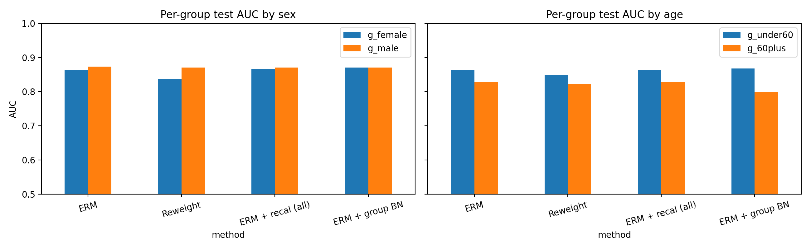

# When Does Batch-Norm Recalibration Help Fairness? Skin-Lesion Classification Across Sex and Age

**Question:** In my previous project, re-estimating batch-norm (BN) statistics fixed federated learning failures caused by hospital-specific stain and scanner shifts. Does the same idea, applied per patient group, make a skin-lesion classifier fairer across sex and age?

## Data
- **HAM10000** dermoscopy images (Hugging Face `marmal88/skin_cancer`), resized to 64×64
- **Task:** benign vs. malignant (melanoma, basal cell carcinoma, actinic keratosis)
- **Data cleaning:** the Hugging Face splits contain 13,354 rows but only 10,015 unique images, so I removed duplicates by image ID. After dropping images with missing age or sex: 9,948 images, 19.6% malignant.
- **Leakage control:** split by **lesion ID** (75/25), so no lesion appears in both training and test (7,505 train / 2,443 test)
- **Groups:** sex (female/male) and age (under 60 / 60+). Malignancy is strongly age-dependent: 9–11% under 60 vs. 35–38% for 60+.

## Methods
- **ERM:** standard training (small CNN with BN, 10 epochs, 2 seeds)
- **Reweight:** group-balanced loss reweighting over sex × age × label cells
- **ERM + recal (all):** BN statistics re-estimated on all training images (control)
- **ERM + group BN:** BN statistics re-estimated separately for each group, from that group's unlabeled training images
- **Metrics:** overall AUC, per-group AUC, gap (max − min group AUC), and equity-scaled AUC = AUC / (1 + Σ|AUC_group − AUC|)

## Results (mean of 2 seeds)

| Groups | Method | AUC | Gap | ES-AUC |
|---|---|---|---|---|
| Sex | ERM | 0.872 | 0.009 | 0.864 |
| Sex | Reweight | 0.861 | 0.033 | 0.834 |
| Sex | ERM + recal (all) | 0.871 | 0.004 | 0.866 |
| Sex | ERM + group BN | 0.870 | 0.004 | 0.867 |
| Age | ERM | 0.872 | 0.035 | 0.829 |
| Age | Reweight | 0.861 | 0.027 | 0.820 |
| Age | ERM + recal (all) | 0.871 | 0.035 | 0.828 |
| Age | ERM + group BN | 0.837 | 0.069 | 0.783 |

### Calibration by age (seed 1)

| Age group | True malignant rate | Mean prediction (ERM) | Mean prediction (group BN) | Within-group AUC (ERM → group BN) |
|---|---|---|---|---|
| Under 60 | 0.102 | 0.104 | 0.134 | 0.869 → 0.874 |
| 60+ | 0.363 | 0.248 | 0.206 | 0.834 → 0.801 |

## Findings
1. **The disparity is by age, not sex.** ERM is about 3.5 AUC points worse for patients 60+, while the sex gap is under 1 point.
2. **ERM underestimates risk for older patients.** It predicts an average of 24.8% for a group with 36.3% malignancy, while staying well calibrated for younger patients (10.4% vs. 10.2%), a disparity that AUC alone does not reveal.
3. **Group-balanced reweighting doesn't help.** It lowers overall AUC by about 1 point, and for sex it widens the gap, mainly by lowering AUC for women (≈0.86 → 0.84).
4. **Group-specific BN by age makes things worse.** It pulls the two groups' predictions together (a 7.2-point gap in mean prediction vs. a true 26.1-point prevalence difference), lowers within-group AUC for patients 60+ (0.834 → 0.801), and doubles the AUC gap.
5. **When BN recalibration helps:** it helps when the group difference is unrelated to the diagnosis (stain and scanner shifts across hospitals, see my [federated learning project](https://github.com/Bhuvan152/fl-blood-cell-heterogeneity)) but hurts when it's tied to disease prevalence (age), because per-group normalization removes diagnostically relevant signal.

## Limitations
- Small CNN at 64×64; 2 seeds; calibration analysis from one seed
- Group BN requires the patient's group at test time
- HAM10000 has no skin-tone labels, so skin-tone fairness is not evaluated
- Age is binarized at 60

## How to run
Open the notebook in Google Colab and run all cells (CPU, about 1.5 hours including download).
